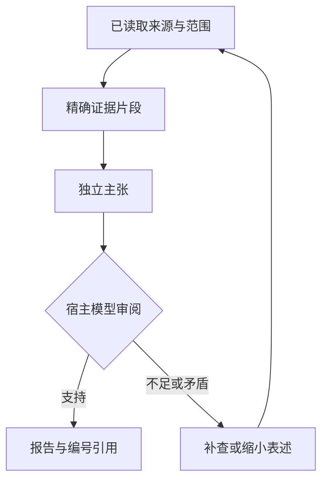

# Deep Research Agent

**在 Codex、Claude Code 或 ds-harness 中，用一句话启动多轮检索、证据核查和带引用的研究报告。**

```text
帮我调用 deep-research-agent，深度研究「你的问题」。
阅读原始来源，补充检索和反证，生成带引用的中文报告，并列出证据缺口。
```

版本：**0.6.0** · Python：**3.11+** · 默认语言：中文 · 文档核对日期：2026-11-11

> 这是一个由当前宿主模型主持的研究工作流，配有本地证据工具。它复现 Perplexity 式研究的公开流程，不是 Perplexity 官方客户端，也没有复刻其服务端、私有搜索索引、模型训练或质量保证。

0.6.0 新增：标准 DSH bundle 插件安装方式，可从本地目录、.tgz、GitHub 或发布后的 npm 包安装；附市场发布材料。保留全文优先、来源规划、23个证据工具和原有 Python 安装方式。**当前为可发布安装包，尚未在 npm 或插件市场上架。**

## 目录

- [1. 这个是什么？](#1-这个是什么)
- [2. 需要准备什么？](#2-需要准备什么)
- [3. 安装与第一次调用](#3-安装与第一次调用)
- [4. 三个宿主分别怎么用？](#4-三个宿主分别怎么用)
- [5. 一次深度研究具体做什么？](#5-一次深度研究具体做什么)
- [6. 与 Perplexity 深度研究相比，能还原什么？](#6-与-perplexity-深度研究相比能还原什么)
- [7. 搜索服务与 API Key](#7-搜索服务与-api-key)
- [8. 报告、引用和审计记录](#8-报告引用和审计记录)
- [9. 命令行、MCP 与开发](#9-命令行mcp-与开发)
- [10. 测试与验证范围](#10-测试与验证范围)
- [11. 常见问题和排查](#11-常见问题和排查)
- [12. 上传 GitHub、更新与移除](#12-上传-github更新与移除)
- [13. 已知限制与后续改进](#13-已知限制与后续改进)
- [14. 官方参考与项目关系](#14-官方参考与项目关系)

## 1. 这个是什么？

本项目把一次研究变成可以执行、留痕和检查的流程：先拆解问题，再搜索与阅读原始材料，逐条记录证据，把结论绑定到证据，检查不足后继续搜索，最后生成报告。

你日常只需要在宿主里提出问题。**宿主模型负责规划、理解、分析、审阅和写作；Python 工具负责记录证据、检查引用关系、保存状态和导出文件。** Python 程序不会再向另一家语言模型发送研究任务，因此无需为本项目额外配置模型 API Key。宿主自身的登录、订阅或模型配置仍然需要正常可用。

| 组成 | 作用 | 你是否需要手动操作？ |
|---|---|---|
| 命名研究工作流 | 让模型在指定问题上执行完整研究流程 | 安装一次，之后自然语言调用 |
| 当前宿主模型 | 规划检索、阅读、推理、决定是否补查 | 按正常方式使用宿主 |
| 宿主搜索/阅读工具 | 获取真实联网资料或读取文件 | 已有工具可直接复用 |
| 可选检索后端 | 宿主缺少搜索时，使用十种可配置检索渠道，自动选择与回退 | 只填想用的渠道 Key；其余留空 |
| 本地证据工具 | 保存原文、精确引用、主张、审阅和查询记录 | 由模型调用 MCP 或命令行 |
| 报告导出 | 生成 Markdown、HTML、JSON 审计记录 | 由模型调用导出工具 |

适合文献初步梳理、方法比较、技术调研、政策与产品资料核对。对于学术问题，流程要求保留研究对象、物种、组织、实验条件和读取范围，区分关联、推断和因果证据。它不能替代预先注册、数据库覆盖完整的系统综述。

### “Agent”在这里是什么意思？

三个宿主使用同一个名字 `deep-research-agent`，但不强行假装它们有完全相同的内部机制：

| 宿主 | 实际载入形式 | 是否由本安装器配置独立子 Agent？ |
|---|---|---|
| Codex | 研究工作流 + MCP；也能回退到终端 | 否，默认由当前会话执行 |
| Claude Code | 工作流 + 同名自定义子 Agent + MCP | 是，子 Agent 设置 `model: inherit` |
| ds-harness / DSH | 新：标准 bundle 挂载工作流与 MCP；原 Python 安装方式仍可用 | 否，仍由当前宿主模型执行 |

宿主能够理解一句话调用，不等于研究会在后台永久运行；实际执行仍受会话、工具权限、网络和模型额度约束。

## 2. 需要准备什么？

| 项目 | 必须？ | 具体要求 |
|---|---|---|
| Python | 是 | 3.11 或以上；在宿主实际运行的环境中可执行 |
| 一个宿主 | 是 | Codex、Claude Code、ds-harness 三选一即可，无需全部安装 |
| 宿主模型可用 | 是 | 能正常对话、调用工具；使用宿主原有登录或模型配置 |
| 文件与终端权限 | 是 | 能读工作流、执行本地 Python、写研究目录；MCP 可减少终端调用 |
| 联网搜索能力 | 联网研究必须 | 宿主已有搜索工具，或配置可选检索服务 Key |
| 原文阅读能力 | 联网研究必须 | 宿主网页/PDF 阅读器，或本项目的直接公开网页读取器 |
| Perplexity 账号 | 否 | 使用原生搜索或 Tavily 时不需要；Search API 路径需相应开发者 Key |
| 额外语言模型 API Key | 否 | 本工具不单独调用语言模型；DSH 自身的模型配置照常需要 |
| `pypdf` | 可选 | 仅直接读取 PDF 文字时需要：`python -m pip install pypdf` |
| Git、Node.js、REA | 本项目运行不需要 | Git 仅用于管理仓库；宿主自身的依赖按宿主说明准备 |

先确认：

```bash
python --version
```

Windows 也可以使用 `py -3.11`，或你已安装的更高版本。macOS/Linux 可能使用 `python3`。后续命令中的 `python` 可替换为你的实际命令。

**Windows、WSL、远程 Linux 和容器属于不同环境。** 例如 Claude Code 在 WSL 中运行，就在 WSL 中执行安装；不要把 Windows 的 Python 绝对路径写进 WSL 配置。

## 3. 安装与第一次调用

### 3.1 解压并安装

解压项目，在含有 `Install_Deep_Research_Agent.py` 的目录执行：

```bash
python Install_Deep_Research_Agent.py
```

默认安装到**当前用户**，同时准备三个宿主的入口；不会安装三个宿主本身。只想配置其中一个时：

```bash
python Install_Deep_Research_Agent.py --hosts codex
python Install_Deep_Research_Agent.py --hosts claude
python Install_Deep_Research_Agent.py --hosts dsh
```

执行三条命令没有必要，选择与你的环境对应的一条即可。支持逗号分隔组合，例如 `--hosts codex,claude`。

### 3.2 首次研究

在所选宿主中新建会话，输入：

```text
帮我调用 deep-research-agent，研究「单细胞轨迹分析与 SCENIC 应如何整合筛选候选转录因子」。
优先原始论文和官方文档，区分相关性与因果证据。
核对实际读取的原文，补充反证和方法限制，生成带引用的中文报告。
```

正常过程应包含：研究范围与子问题、实际搜索/读取调用、证据记录、缺口检查、后续查询和报告文件。**只有一段模型回答，没有真实搜索/阅读记录，不算完成联网深度研究。**

### 3.3 其他安装选项

```bash
# 只预览拟修改的文件，不写入
python Install_Deep_Research_Agent.py --dry-run

# 只给指定项目安装；用项目实际路径替换参数
python Install_Deep_Research_Agent.py --project /absolute/path/to/your-project

# 只安装工作流与本地工具，不改 Codex/Claude 的 MCP 配置
python Install_Deep_Research_Agent.py --without-mcp
```

Windows 的项目参数示例：`--project "C:\Users\YourName\research-project"`。项目级配置是否载入仍取决于宿主对项目的信任和加载规则。

安装器先解析现有配置；有冲突则明确报错。需要改动的既有文件旁会保留带时间戳的备份。它不会改变宿主的自动批准规则。

### 3.4 文件安装到哪里？

以下是默认用户级路径，`~` 表示当前用户目录：

| 文件/目录 | 用途 |
|---|---|
| `~/.agents/skills/deep-research-agent/` | Codex 工作流入口 |
| `~/.claude/skills/deep-research-agent/` | Claude Code 工作流入口 |
| `~/.claude/agents/deep-research-agent.md` | Claude Code 同名子 Agent |
| `~/.dsh/skills/deep-research-agent/` | DSH 工作流入口；设置了 `DSH_HOME` 时遵循它 |
| `~/.codex/config.toml` | 合并写入 `mcp_servers.deep_research`；遵循 `CODEX_HOME` |
| `~/.claude.json` | 合并写入用户级 `mcpServers.deep_research` |
| `~/.local/share/deep-research-agent/runtime/` | MCP 后端脚本 |
| `~/.local/share/deep-research-agent/research.env` | 可选检索服务配置 |
| `~/.local/share/deep-research-agent/runs/` | MCP 默认研究数据库和报告 |
| `~/.local/share/deep-research-agent/dsh-mcp.yaml` | DSH 可选 MCP 注册片段 |
| `~/.local/share/deep-research-agent/START_HERE.md` | 按本机绝对路径生成的使用提示 |

项目级安装改用项目中的 `.agents/skills/`、`.claude/skills/`、`.claude/agents/`、`.dsh/skills/` 和 `.deep-research/`；Codex 配置写入 `.codex/config.toml`，Claude MCP 配置写入 `.mcp.json`。


### 从 GitHub 地址让宿主安装

将本包源码上传到 https://github.com/champeil/deep_search_agent 后，可以在 Codex、Claude Code 或 DSH 里说：

```text
帮我从 https://github.com/champeil/deep_search_agent 安装 deep-research-agent。
先阅读 README 和安装器，按当前宿主安装；保留已有配置和 Key。
安装后检查工具是否可发现，不要替我申请账号或购买 API。
```

这是一条交给有终端/网络权限的编码宿主执行的自然语言任务，**不是所有产品通用的官方“一键 URL 安装”协议**。宿主可能要求项目信任、文件写入或联网批准。没有执行工具的聊天窗口只能给说明；不能声称已经安装。仓库未公开或地址为占位符时，需要先提供真实且有访问权限的地址。

## 4. 三个宿主分别怎么用？

### Codex

自然语言：

```text
帮我调用 deep-research-agent 深度研究这个问题：……
```

显式指定工作流：

```text
$deep-research-agent 深度研究……并输出带引用报告。
```

安装器写入标准工作流目录和本地 stdio MCP 配置。模型应能看到 `research_begin`、`research_source` 等工具；宿主可能给工具加服务器命名空间。未载入 MCP 时，工作流可通过终端执行同一套 Python 工具。

### Claude Code

请求同名子 Agent：

```text
请使用 deep-research-agent 子 Agent 研究……并返回报告与引用。
```

或者显式调用工作流：

```text
/deep-research-agent 研究……
```

两种形式不同：第一种请求子 Agent，第二种是工作流命令。默认子 Agent 继承当前模型；工具与权限受 Claude Code 本身及组织配置约束。可以通过宿主的 Agent/MCP 管理界面检查是否发现入口。

### ds-harness / DSH

**新增方式：安装标准 DSH 插件 bundle。** 当前兼容验证基线是 DSH 0.2.2-rc.1、Node >=24.9.0、Python >=3.11。进入解压后的项目，使用实际绝对路径：

```sh
dsh plugin --profile web add /绝对路径/deep-research-agent
dsh --profile web --dump-config
dsh --profile web
```

也能安装本次提供的 `dsh-deep-research-agent-0.6.0.tgz`。插件会挂载同名工作流，以及 `mcp__deep_research__research_*` 的23个证据工具。首次激活检查 Python，创建缺失的私有 research.env，保留已有 Key；使用当前宿主模型，不修改现有模型或批准规则。

GitHub 安装需先将本包源码上传到 champeil/deep_search_agent，然后使用 `dsh plugin --profile web add github:champeil/deep_search_agent`；npm 安装需先实际发布，不能把尚未发布的示例包名当作已上架包。完整配置、卸载、GitHub/npm 发布和社区市场提交见 [DSH_PUBLISHING.md](DSH_PUBLISHING.md)。

如果已经手工挂载同名 deep_research MCP，请移除重复条目，或为插件设置不同 serverName。标准 web profile 提供 skills/tools 服务；自定义 profile 也需要它们。

安装后默认使用：

```text
调用 deep-research-agent，深度研究……
```

**原有 Python 安装方式：** 所选 profile 需要启用文件工作流发现、读取和终端执行能力。Python 安装器只放入相应工作流文件，**不会自动改写 DSH 的 Cordis composition**。因此，默认可以由模型使用终端调用证据后端，不要求先配置 MCP。

希望把证据工具也列入 DSH 工具列表时，将生成的 `dsh-mcp.yaml` 条目加入实际使用的 Cordis scope/composition。文件已经包含当前 Python、运行脚本、报告目录和环境文件的绝对路径；不要直接照抄其他电脑的路径。[DSH 官方配置说明](https://github.com/deepseek-ai/deepseek-harness/blob/master/packages/mcp/mcp-client/README.md)

片段形状如下，`<...>` 需要替换，本例不是可直接执行的配置：

```yaml
- id: mcp-deep-research
  name: '@deepseek-ai/dsh-mcp-client'
  config:
    serverName: deep_research
    transport: stdio
    command: '<absolute-python-executable>'
    args:
      - '<absolute-path>/research.py'
      - serve
      - --root
      - '<absolute-path>/runs'
      - --env
      - '<absolute-path>/research.env'
    toolCallTimeoutMs: 60000
```

## 5. 一次深度研究具体做什么？

### 5.1 执行步骤

| 步骤 | 模型执行的研究行为 | 工具保留什么？ |
|---|---|---|
| 1. 确定范围 | 明确时间、地区、物种、对象、版本等；必要时澄清 | 研究问题和创建时间 |
| 2. 拆分子问题 | 通常形成 3–6 个问题，分配权重 | 子问题 ID、问题文本和权重 |
| 3. 首轮检索 | 为子问题设计查询，发现原始来源 | 真实查询、轮次、目的、提供方和结果数量 |
| 4. 阅读原文 | 阅读相关正文、方法、图注、表格或补充材料 | 实际返回文本、来源 URL、读取范围、工具引用和文本哈希 |
| 5. 抽取证据 | 选择原文中确实存在的连续短片段 | 证据 ID、精确文本、字符偏移和位置说明 |
| 6. 提出主张 | 将报告结论拆成可核查的独立陈述 | 主张 ID、对应子问题、证据 ID、事实/推断标签 |
| 7. 逐条审阅 | 重看上下文，检查数字、否定、条件和因果措辞 | 审阅结果、简短理由和历史 |
| 8. 检查覆盖 | 找出未回答的问题、冲突和不充分证据 | 覆盖情况、缺失问题、待审主张 |
| 9. 补查与反证 | 根据缺口改写查询；后续轮次检索相反或限制性证据 | 新查询及 `gap` / `counter` 目的 |
| 10. 停止与输出 | 满足范围或预算用尽；明确写出限制 | 报告、引用、停止原因和审计文件 |

“发现来源”与“读到原文”是不同动作。搜索摘要只用于发现，不能冒充全文；只能读到摘要时必须记为 `abstract`。不能访问的方法和补充材料应列为缺口。

### 5.2 快速模式和研究模式

| 参数 | `quick` 快速模式 | `research` 研究模式（默认） |
|---|---|---|
| 用途 | 窄问题、事实核对 | 多角度方法比较、文献与技术调研 |
| 记录的查询预算 | 4 条 | 18 条 |
| 来源记录预算 | 6 个 | 30 个 |
| 轮次上限 | 2 轮 | 4 轮 |
| 发布为 `audited` 的检索要求 | 至少有真实查询记录 | 至少两轮记录，且后续轮次含反证查询 |
| 共同要求 | 发布的主张已审阅、引用关系完整、全部计划问题有发布主张、停止原因符合条件 | 同左 |

这些是后端**记录和调用的上限**，不是已经完成了多少研究的承诺。来源数也不等于独立研究数。宿主原生搜索发生在后端之外，必须由模型如实登记；后端不能截获或强制限制所有宿主搜索。

当前版本的预算写在 `research.py` 中，尚无命令行自定义预算选项。需要更大规模时可以改源码并重建安装器，但不应直接改研究数据库来制造完成状态。

### 5.3 如何停止？

模型应在关键问题得到足够证据、重要冲突已解释时停止；预算用尽或工具受限时输出部分报告。不能通过增加无关来源或重复查询伪装“深度”。后端的覆盖率只是“该子问题有没有通过审阅的主张”的加权比例，**不是问题已被科学上完整回答的概率**。

### 5.4 领域识别、专业来源与覆盖记录（0.4.0）

**默认流程：识别多个相关领域 → 组织关键词组 → 选择少量互补来源 → 实际检索和阅读 → 根据缺口扩展 → 报告实际覆盖。** 不把一张来源清单当成已经搜索过的证据。

`research_begin` 在本地按中英文关键词生成来源建议，不调用额外模型、不联网。**它是初步提示，不是训练过的全领域语义分类器。** 当前宿主模型随后用 `research_plan` 确认领域、同义词、来源、物种/人群、时间和地区；不确定时保留通用与开放检索，不强行分类。

首版来源清单含 **11 个领域类别、36 个去重来源入口**。同一来源可用于多个领域，这不是 36 个已经直接接好的 API，也不表示覆盖所有国家、语言和专业。

| 领域 ID | 示例来源 | 本版访问方式 |
|---|---|---|
| general 通用 | Crossref、OpenAlex、DOAJ | Crossref 直接 API；其余宿主工具/站内搜索 |
| biomed 生物医学 | PubMed、Europe PMC、PMC | 前两者直接 API；PMC 用于读取可访问原文 |
| omics 组学 | GEO、SRA、ENA、CELLxGENE | 宿主工具/站内搜索，按数据记录核对 |
| clinical 临床 | ClinicalTrials.gov、PubMed、Cochrane、WHO | PubMed 直接 API；其余宿主工具/网站；部分全文需订阅 |
| computing 计算机 | arXiv、ACL Anthology、OpenReview、GitHub | 宿主工具/站内搜索，核对评审和版本状态 |
| engineering 工程 | IEEE Xplore、ACM、NIST、ISO | 宿主工具/站内搜索，标准/全文可能受限 |
| economics 经济金融 | World Bank、IMF、OECD、SEC | 宿主工具/站内搜索，核对国家和指标口径 |
| policy 政策法律 | EUR-Lex、中国政府网、GOV.UK | 仅是不同管辖区的起点，必须按问题补充相关国家/地区 |
| environment 环境 | IPCC、NOAA、NASA、FAO | 宿主工具/站内搜索，核对数据产品和版本 |
| social 社会科学 | OSF、ERIC、OECD、Crossref | Crossref 直接 API；其余宿主工具/站内搜索 |
| humanities 人文 | JSTOR、Library of Congress、DOAJ、Crossref | Crossref 直接 API；其余宿主工具/站内搜索 |

例如“肿瘤内皮细胞的单细胞异质性与治疗反应”可以同时选择 biomed、omics、clinical。PubMed/Europe PMC 用于发现文献，PMC/出版社原文用于阅读，GEO/CELLxGENE 用于定位数据，临床试验登记用于核对试验背景；不会把这些资料的用途混在一起。

关键词使用概念组：组内同义词 OR，组间 AND。模型应按子问题分别设计查询，不要把所有机制、疾病、实验方法都塞入一条式子导致漏检。当前没有自动验证 MeSH 主题词或把中文自动翻译为数据库规范检索式的独立程序；宿主模型负责这一步并核对真实返回结果。

```json
{
  "run_id": "工具返回的真实运行ID",
  "domains": ["biomed", "omics", "clinical"],
  "concepts": [
    {"terms": ["tumor", "cancer"]},
    {"terms": ["endothelial cells", "tumor endothelium"]}
  ],
  "source_ids": ["pubmed", "europepmc", "pmc", "geo"],
  "required_source_ids": ["pubmed", "europepmc"],
  "policy": "preferred",
  "task": "academic",
  "reason": "文献发现与公开组学数据相互补充"
}
```

这段是 `research_plan` 的参数示例，由模型调用；平时不需要你手写。

### 5.5 真正查询数据库，与站内搜索分开

新增 `research_database_search`：

| 数据库 | 直接接口返回 | 正常一次逻辑查询对应 HTTP 数 | 需要额外 Key？ |
|---|---|---|---|
| PubMed | ESearch 检索结果 + EFetch 元数据/摘要、可用 PMC 链接 | 通常 2；无命中通常 1 | 本适配器不需要；保守限速 |
| Europe PMC | core 文献元数据、可用摘要与全文链接 | 通常 1 | 不需要 |
| Crossref | DOI/文献元数据，部分记录有摘要 | 通常 1 | 不需要 |

先使用宿主可用的数据库原生工具；缺少/失败/不足时，再使用上述适配器。它们是对具体数据库的检索，不属于原有十个商业搜索服务的排序，也不会因为没填商业 Key 就失效。**一般网页检索仍沿用自带工具 → Perplexity → 已配置渠道的顺序。**

每个数据库 HTTP 请求都计入现有远程请求上限，包括失败请求。PubMed 的两步请求分开计数，达到上限就停止；三个新增数据库适配器当前不使用商业搜索缓存，不做自动重试。不同研究目录/机器仍可能共享同一出口 IP 的服务限额。

结果中的 `abstract` 或 `metadata` **不代表全文已经读取**。全文、图表与补充材料仍按原有阅读路径处理。Crossref 元数据不是研究质量背书；发表类型、预印本和撤稿状态仍需核对，当前不是完整的自动撤稿筛查系统。

### 5.6 按缺口扩展，不把清单锁死

默认 `policy=preferred`：先用计划来源，发现缺口后允许开放搜索和增补来源。来源清单不全时，模型可以更新领域/同义词、选择已有的其他来源，或实际阅读一个新站点后通过 `research_add_source` 注册到本次运行。新来源须有已保存的对应页面作为依据，不能只凭模型生成的网站名称或 URL 加入；注册标为宿主陈述，不代表独立认证了该网站的权威性。

动态注册不会创建 API、不自动运行网页提供的代码，也不把新站点自动升级成全局可信来源。记录和理由保留在本次运行及审计文件，长期常用来源可再维护到带版本的 source-registry.json。

可选 `strict_domains` 用于用户明确要求的来源网站 URL 前缀限制：过滤候选结果、拒绝保存范围外文本，并在发布时检查引用 URL。站内查询只提供 best effort 范围提示，无法强制搜索服务内部只检索某个库。**域名限制不等于数据库收录范围限制**：Crossref 中某论文的 doi.org/出版社链接也可能被该模式过滤，所以默认不启用。已有范围限制时不得由模型自行放宽。

法律政策任务需核对管辖区；专业数据任务需核对数据类型。未知领域保留通用检索，不能因为清单里没有相应类别就声称“没有证据”。

### 5.7 报告怎样显示实际覆盖？

| 情况 | 记录方式 | 是否算原生数据库已检索？ |
|---|---|---|
| 只是把 PubMed 列在计划里 | planned | 否 |
| 搜索引擎查询 `site:pubmed.ncbi.nlm.nih.gov` | site_search | 否 |
| 只打开一篇 PubMed/PMC 页面 | 读取条目及范围 | 否 |
| PubMed 直接 API 或宿主数据库工具真正查询 | database_api / native_database | 是，但不代表穷尽检索 |
| 无权限、错误、暂时不可用、主动不查 | failed / unavailable / skipped，加原因 | 否 |

来源覆盖矩阵展示已计划、原生数据库查询、站内搜索、实际读取数量和范围、最新失败/跳过原因。宿主记录的查询有 `host_attested` 标记，后端 API 请求有对应响应记录；工具不能独立证明宿主陈述是真的。

`required_source_ids` 表示用户要求必须执行原生查询的数据库。它们尚未完成时，即使其他主张、轮次条件已满足，报告也只能是 `partial`；站内搜索不能替代。普通“优先来源”不要求全部查完，可按相关性和预算跳过并解释。演示材料仍强制标记 `demonstration`。

新计划、变更历史、来源尝试记录和覆盖矩阵会写入 `audit.json`；Markdown/HTML 报告加入“检索来源与覆盖”。即便所有必查库都查询过，也不宣称系统综述级完整覆盖。

日常调用示例：

```text
调用 deep-research-agent，研究肿瘤内皮细胞异质性与治疗反应。
先识别相关领域，制定关键词和互补来源计划，展示简要计划后直接研究。
要求实际检索 PubMed 和 Europe PMC，优先读全文与 PDF；
根据证据缺口补充其他来源，报告列出实际检索范围、未覆盖来源及原因。
```

### 5.8 全文优先，摘要作为明确降级（0.5.0）

**论文阅读默认优先级：可访问的全文 → 实际摘要 → 无内容证据时保留缺口。** HTML、结构化 XML 和 PDF 是正文的不同载体，按可访问性和版本一致性选择，不因 PDF 格式就认定证据更好。先扫摘要判断相关性可以，但有全文时不能停留在摘要。

全文重点阅读 **Introduction → Results → Methods → Abstract**：

| 部分 | 阅读重点 |
|---|---|
| Introduction | 研究问题、背景、假设和已有证据边界 |
| Results | 实际观测、效应方向与数值、分组条件、与结论对应的图表 |
| Methods | 样本、物种/人群、干预与对照、分析流程、统计方法、影响因果解释的设计 |
| Abstract | 与正文核对，确认摘要是否概括过度或遗漏条件 |
| 按主张补读 | 图注/表格、Discussion、局限性和补充材料；需要时使用视觉工具 |

综述、短文或特殊格式可能没有独立 Methods/Results/Abstract：应定位实际整合的相关段落，或基于已读正文记录章节确实未独立设置及原因。不能因为预览只显示前半篇、解析被截断或章节没有定位到，就把该部分标成不存在。重点阅读应覆盖章节实质内容，不能用标题或一句可引用的话代表已经阅读该章节。

全文路径失败后，再尝试合理的公开替代路径（如期刊/PMC HTML、公开 XML 或 PDF），通常单篇最多尝试三个正文路径后重新评估优先级，并受总预算约束。已知链接缺失时，用 DOI/PMID/实际标题定位全文；不得拼造未核对的文章地址。拿不到全文时，可以只读真实摘要，并记录是付费墙、链接无正文、网络错误、OCR 需求、来源限制还是预算结束。**这些原因不等于“全文不存在”。** 没有摘要时也不能把标题、搜索 snippet 或 DOI 元数据当成论文内容证据。

数据库检索结果提供 `reading_candidates`：用于所选论文的标识、正文候选链接与摘要页提示；存在 PMCID 时可提供 PMC HTML/公开 XML 候选。它们不会自动发起额外抓取，链接本身也不代表全文可访问。先筛选有用论文再注册阅读，避免每条搜索结果都下载全文。

### 5.9 其他资料也优先读取原始细节

| 资料类型 | 优先阅读内容 | 原始内容不可得时 |
|---|---|---|
| 技术文档 technical | 对应版本、正式接口/规范、参数、限制；补读示例与错误行为 | 使用官方摘要/README，并说明未核对的正式细节 |
| 政策法律 policy | 适用范围与管辖区、正式条款、生效日期、例外；定义及修订 | 使用官方解读/摘要，不能冒充已读条文 |
| 数据集 dataset | 数据来源、字段字典、采集/处理方法、限制；核对数据与版本 | 使用数据集简介，不能推断未核对的字段或实验条件 |
| 新闻 news | 原始声明/文件、日期、上下文、证据限制；补充原始来源交叉核对 | 使用报道摘要并说明原始证据缺失 |
| 财务 business | 报告期间、正式报表、附注、风险；相关方法 | 使用官方摘要，不能冒充完整申报文件核查 |
| 一般资料 general | 原始证据、方法、限制、摘要 | 明确标注仅摘要及未读内容 |

这里的优先级规定阅读动作，不是来源内容一定正确的保证。所有结论仍需与实际阅读范围匹配，并完成原有逐条主张审阅。

### 5.10 怎样记录“取到了”和“读过了”？

新增四个工具，由模型按流程调用，日常无需手写参数：

| 工具 | 作用 |
|---|---|
| research_document | 为选定文献/资料登记类型、标识、正文与摘要候选 URL，返回 document_id |
| research_reading_plan | 显示候选优先级、重点章节、实际进度和降级原因；不联网 |
| research_document_attempt | 记录实际访问/发现失败或明确预算、范围限制；不能用一个成功标记伪造阅读 |
| research_document_read | 记录实际阅读段落的 source_id、章节名称及字符范围，附标题/DOI/版本身份核对说明 |

`research_read`、`research_extract`、`research_source` 支持可选 document_id，把实际获得文本关联到资料。来源 URL 必须先登记；原生阅读器取得的文本仍要保留实际 read_scope 与工具出处。直接读取公开 XML 可输出带章节标题的规范化文本；API/直接读取仍保守保存 partial_text，不因为返回很多字就宣布全文阅读完成。

**“取得正文”不等于“读过重点章节”。** 章节提示仅用于定位；模型需要实际查看正文窗口并登记阅读范围。字符偏移、来源存在性和范围可以检查，但章节语义与是否理解仍是宿主模型陈述，不是工具独立认证。全文获取与阅读受原有页数/字符上限约束，扫描 PDF、复杂表格、图像和补充材料仍可能需要其他阅读工具。

| 阅读等级 | 实际含义 |
|---|---|
| primary_sections | 重点正文/原始资料章节已有阅读记录；适用的缺失章节有基于原文的理由。不是逐字读完整篇及所有附件的保证 |
| partial_primary | 已读部分正文，但重点章节还不完整 |
| summary_with_primary_unread | 已取得原始正文却只读了摘要；应继续读，不能直接算摘要降级 |
| abstract_only / summary_only | 实际只读摘要；已记录已知正文路径失败或真实定位检索未找到正文 |
| abstract_only_limited / summary_only_limited | 受预算/来源范围等限制，只读摘要；不能断言全文不可得 |
| fallback_unresolved | 已读摘要，但正文路径或定位尚未解决 |
| not_read | 没有实际章节阅读记录，即使已经下载文本 |

已引用资料若登记了文档但重点阅读尚未完成，发布会降为 `partial`。合理的摘要降级可以进入报告，但会列出阅读等级与原因，且摘要未提供的方法/数据不能被补写成事实。旧版未登记文档的来源继续兼容，但没有章节阅读检查，不能把 page_text 标签当成已执行新策略。

Markdown/HTML 报告增加“资料阅读范围”，audit.json 保存 documents 与 reading_coverage。不需要额外语言模型 Key，也不增加一个模型来代读；仍由当前宿主模型完成阅读和审阅，消耗宿主原有上下文额度。

使用方式：

```text
调用 deep-research-agent 研究某个问题。
资料按全文/原始内容优先，失败后才降级到真实摘要。
论文重点阅读 Introduction、Results、Methods、Abstract，按需要补读图表与补充材料。
报告列出实际阅读章节、摘要降级原因和无法核对的内容。
```

## 6. 与 Perplexity 深度研究相比，能还原什么？

### 6.1 比较依据

Perplexity 的公开介绍描述了反复搜索、阅读、根据新信息调整计划，再写报告的过程。[P1] 其当前 Computer 产品页还描述并行检索、模型路由和数据源整合等能力。[P2] 这些是公开产品说明，不是可逐项验证的内部源码规范。

以下“已实现”指本仓库确有对应代码或工作流；“依赖宿主”指效果取决于当前模型和工具；“未实现”指本项目没有提供该能力。**不提供未经基准测试的还原百分比。**

### 6.2 按研究步骤比较

| 环节 | Perplexity 公开表现/定位 | 本项目做法 | 还原程度与实际边界 |
|---|---|---|---|
| 自然语言启动 | 以问题启动研究 [P1] | 命名入口、工作流、Claude 子 Agent | **已实现入口**；各宿主机制不同 |
| 研究计划 | 研究中调整计划 [P1] | 模型先拆子问题，再根据缺口补查 | **依赖宿主执行**；不是独立规划算法 |
| 多轮搜索 | 反复搜索 [P1] | 记录 `discovery/gap/counter` 与轮次 | **已实现记录和预算**；查询质量由模型决定 |
| 阅读材料 | 搜索后阅读资料 [P1] | 原生阅读器优先，直接读取器可选 | **部分实现**；网页脚本、登录与扫描图像依赖宿主 |
| 跨来源整合 | 综合资料形成报告 [P1] | 模型整合，并逐条绑定证据 | **依赖宿主理解**；无同等质量保证 |
| 继续调查缺口 | 按新信息迭代 [P1] | 查询覆盖情况，针对冲突和限制补查 | **流程已实现**；是否真正找到反证仍取决于检索 |
| 最终报告 | 研究后写综合报告 [P1] | 按子问题输出已审阅主张与局限 | **已实现基础输出**；没有复杂报告编辑器 |
| 引用输出 | 提供带来源的研究产物 [P2] | 由保存的来源生成编号与 URL | **已实现引用关系检查**；不自动证明来源真实或结论正确 |
| 文件与网页结合 | 产品支持多类上下文 [P2] | 可导入宿主读出的文件与网页文本 | **部分实现**；无内置云盘连接器 |
| 并行研究 | 产品描述并行检索 [P2] | 可使用宿主允许的并行工具调用 | **宿主可选**；后端没有自主并行调度器 |
| 模型路由 | 产品描述模型选择/路由 [P2] | 统一使用宿主当前模型 | **未实现**自动多模型路由 |
| 数据源整合 | 产品提供整合的数据能力 [P2] | 原生工具与十种 API；按检索任务及正文提取分别路由 | **部分实现**检索接入；数据授权不随项目附送 |
| 导出与分享 | 提供研究产物导出 [P1][P2] | 原生 Markdown、HTML、审计 JSON | **部分实现**；PDF、Word、分享页需另行转换或宿主工具 |

### 6.3 从代码上，哪些检查真正生效？

以下是本项目自己的工程机制，不宣称是 Perplexity 的内部实现。

| 能力 | 代码会检查什么？ | 不能据此推断什么？ |
|---|---|---|
| 原文精确匹配 | 证据必须是保存文本中的连续子串；保存偏移 | 不能证明导入文本确实来自该 URL |
| 来源与引用关系 | 主张只能引用已有证据 ID；禁止伪造编号与内联 URL | 不能证明原文真的在语义上支持主张 |
| 主张发布门槛 | 未审阅或非 `supported` 的主张不能发布 | `supported` 仍是模型给出的判断 |
| 内容完整性 | 检查来源哈希、证据偏移和主张审阅是否过期 | 哈希不是数字签名或第三方真实性认证 |
| 多轮与反证 | 研究模式检查已登记的轮次和后续反证查询 | 不能独立证明查询真实发生、检索充分或反证被正确解释 |
| 重复控制 | 同一查询忽略大小写后不能重复登记；完全相同正文标记重复 | 没有语义去重，不能识别全部转载与共同上游来源 |
| 读取范围 | 保存 `abstract/partial_text/page_text` 等标签 | 标签由读取路径和宿主提供；不是全文可读性认证 |
| 缺口和演示标记 | 条件不满足标为 `partial`；测试材料强制 `demonstration` | 不能把 `audited` 理解为人工审计或真实率 100% |
| 持久记录 | SQLite 保存原文、查询、证据、主张和审阅历史 | 没有自主后台恢复、加密数据库或长期托管服务 |

### 6.4 目前不能还原的核心能力

| 能力 | 当前状态 | 对结果的影响 |
|---|---|---|
| 私有全网索引与抓取基础设施 | 没有 | 搜索召回和新鲜度取决于所选服务 |
| 内部检索排序、重排与搜索训练 | 没有 | 无法保证优先找到相同来源 |
| 内部提示词、模型权重和训练配方 | 不掌握 | 无法声明内部行为等同 |
| 托管的大规模并行执行 | 没有 | 运行速度和规模受宿主会话限制 |
| 付费/授权资料访问 | 不附带 | 需用户自己的合法访问和阅读工具 |
| 完整图像、视频、扫描 PDF 理解 | 后端没有 | 需要宿主视觉、OCR 等能力并核对位置 |
| 与 Perplexity 同等的准确率、耗时与稳定性 | 未开展对照评测 | 不作性能与质量等价承诺 |

要接近目标体验，最优先补齐的是**可靠搜索与原文读取**，其次是适合任务的宿主模型、查询设计和结果评估；仅增加提示词长度无法补足资料覆盖。

## 7. 搜索服务与 API Key

### 7.1 默认行为：先用自带工具，再按特长调用已配置 API

**搜索默认顺序：宿主自带搜索 → Perplexity Search → 按任务选择的已配置渠道。** 宿主搜索已经足够时，不额外调用 API；需要补查、宿主失败或没有原生搜索时才进入后续层。不会为了“多渠道”把同一个问题同时发给所有服务。

Python 后端无法直接操纵宿主工具：宿主模型负责执行原生调用。`research_search`/`research_extract` 默认返回 `needs_native`，不联网；模型确认原生工具不可用、失败或不足后，传 `native_status=unavailable|failed|insufficient` 才允许 API 请求。该字段是宿主陈述，不是自动验证原生调用的证明。

在自动模式中，Perplexity 之后按下表选择。**这些是工程路由默认值，不是统一题集实测的质量排名，也不保证任何一家始终最便宜。** 缺少 Key、主动禁用、正在冷却或不支持该操作的渠道自动跳过。

| 任务 | Perplexity 之后的完整默认顺序 | 选择依据 |
|---|---|---|
| 综合研究 balanced | Tavily → Exa → Parallel → Linkup → AnySearch → SerpApi → SerpSearch → Keenable → Firecrawl | 先返回可筛选的研究检索结果，正文抓取另选渠道 |
| 学术/论文 academic | Exa → SerpApi → Parallel → Tavily → Linkup → Keenable → AnySearch → SerpSearch → Firecrawl | 语义发现；SerpApi 使用 Google Scholar；仍须核对原论文 |
| 精确标题、术语 exact | SerpApi → SerpSearch → Tavily → Exa → Parallel → AnySearch → Linkup → Keenable → Firecrawl | 优先传统 SERP 结构，适合定位已知来源 |
| 新闻 news | SerpApi → SerpSearch → Tavily → Parallel → Exa → AnySearch → Linkup → Keenable → Firecrawl | 调用相应新闻入口；发布日期由模型继续核对 |
| 中文 chinese | AnySearch → SerpApi → Tavily → SerpSearch → Exa → Linkup → Parallel → Keenable → Firecrawl | AnySearch 使用 cn zone；SerpApi 设置中文界面参数，不保证覆盖所有中文数据库 |
| 技术/文档 technical | Exa → Tavily → Firecrawl → Parallel → SerpApi → Linkup → AnySearch → SerpSearch → Keenable | 文档与代码来源发现；Firecrawl 使用 developer 类别 |
| 通用质量 quality | Exa → Parallel → Linkup → Tavily → SerpApi → SerpSearch → AnySearch → Keenable → Firecrawl | Tavily advanced、Parallel advanced；其他特定任务保持各自特长顺序 |
| 节约 economy | Tavily → Keenable → AnySearch → Parallel → Exa → SerpSearch → SerpApi → Linkup → Firecrawl | Perplexity fast、Tavily basic、Parallel turbo、Exa lite，减少深度模式的额外消耗 |

`economy` 侧重低消耗模式与可配置优先级，**不会读取你的账户余额、自动购买套餐或计算实时最低价**。免费额度是否剩余、套餐折扣和实际扣费要以账户为准。可用 `RESEARCH_PROVIDER_ORDER` 调整 Perplexity 后的顺序，或在用户明确要求时单次指定 `provider`。对论文研究，除通用搜索外仍应优先使用宿主现有的 PubMed、Europe PMC 等学术工具；本版已捆绑 PubMed、Europe PMC、Crossref 的直接检索适配器；其他来源通过宿主工具或明确标注的站内搜索访问。

### 7.2 渠道比较：搜索质量与性价比应按用途判断

| 渠道 | 本版搜索 | 本版正文提取 | 更适合什么 | 费用/限制应怎样看 |
|---|---|---|---|---|
| 宿主自带 | 由宿主执行 | 网页/PDF 由宿主执行 | 首选，复用当前环境能力 | 无需在本项目配置 Key；仍消耗宿主额度，并非总成本为零 |
| Perplexity | Search API | 无通用正文适配器 | 首选远程综合发现 | 这是 Search API，不是 Deep Research 或 Sonar 报告调用；按开发者账户计费 |
| Tavily | basic / advanced，新闻 | Extract | 研究型检索与网页提取 | basic/advanced、提取深度及成功 URL 影响 credits；截图中的 1,000 是 credits，不等于任意模式下 1,000 次研究 |
| Exa | auto / lite | Contents | 语义发现、论文或技术来源 | 搜索与内容提取分项；只用 Search 不等于已阅读全文 |
| Firecrawl | v2 Search，research/developer 类别 | v2 Scrape Markdown | 网页正文、需要渲染的页面、文档 | 抓取/PDF 页数与模式可能加大 credits；本版搜索不默认抓取每条结果全文 |
| Linkup | standard + searchResults | standard Fetch | 研究来源发现与页面文本 | 只使用检索/提取，不调用它的 Research 或 sourcedAnswer 生成报告 |
| Parallel | V1 Search basic/advanced/turbo | V1 Extract full_content | 面向研究目标的检索片段与页面内容 | 本版 REST 路径需要 PARALLEL_API_KEY；官方另有免费托管 MCP，若已装到宿主可作为原生工具使用 |
| SerpSearch | Web / News | 无 | 传统搜索结果、标题与新闻定位 | SERPSEARCH_API_KEY，与 SerpApi 是不同服务；结果描述不是论文全文 |
| Keenable | 认证 Search 或主动开启 public | Fetch | 低延迟网页检索与文本 | 官方 public 端点可免 Key，需应用标识且共享 IP 限额；默认不开启。无 usage 数据不表示可以推算后台消耗 |
| AnySearch | v1 Search，intl/cn | v1 Extract | 中文/区域检索补充与公开网页文本 | 此处指 anysearch.com；Extract 单次一个 URL，不支持据此保证 PDF 全文；可能截断 |
| SerpApi | Google / Google Scholar / Google News | 无 | 可复现的 SERP、学术标题、新闻定位 | SERPAPI_API_KEY；按套餐 searches 计费，非所有搜索引擎免费额度相同 |

对于你的肿瘤—内皮细胞研究：先从学术渠道找原始研究，再用官方期刊/PMC 的公开 HTML 或 PDF 读取 Methods、Results、图注；遇到需要渲染的页面可转正文提取渠道；拿不到全文时保留摘要并降级证据范围。换更多 API 无法替代“是否原始研究、是否因果实验、是否读取正确段落”的判断。

以下是核对当日公开标价的参考，均不是本次研究的实际扣费，也未计宿主模型、税费或余量。模式和计费单位不同，不能把这一列直接当成质量排序：

| 已核对服务/模式 | 标价参考 | 对性价比的意义 |
|---|---|---|
| Perplexity Search standard / fast | $5 / $1 每 1,000 次成功请求 | economy 使用 fast；不代表与 standard 相同召回 |
| Exa Auto / Lite | $7 / $4 每 1,000 次，基础最多 10 条结果 | economy 使用 Lite；Contents 另列 $1 每 1,000 页/内容类型 |
| AnySearch Pro | $3 每 1,000 calls，当日页面促销价 | 适合作为低价补充；区域、覆盖与质量需要按题目验收 |
| Tavily PAYG | $0.008/credit；搜索 basic 1、advanced 2 credits | 若不用免费额度，对应约 $8/$16 每 1,000 次搜索；提取另计 |
| Linkup Search | $0.005–$0.006/request | 标价约 $5–$6 每 1,000 次；不同深度以账户为准 |
| Parallel Search | 官网说明最低 $1 每 1,000 次 | 不能将最低档价套用到 advanced；官方另有免账号 MCP |
| SerpApi Starter | $25/月含 1,000 searches | 全用完才相当于 $0.025/次；少用时摊销更高，另有免费层 |

来源为本节 7.7 的各家官方价格链接。SerpSearch、Firecrawl、Keenable 等未做统一币值换算，保留各自 credits/套餐/限额规则，避免把截图赠送额度当作长期保证。`economy` 目前选低消耗模式；需要真正按你账户的剩余免费额度和实时价格优化，还要接入账户用量查询。

### 7.3 填 Key：任意几个即可，不需要全买

安装生成的私有配置位置：

- 用户级：`~/.local/share/deep-research-agent/research.env`
- 项目级：`<项目>/.deep-research/research.env`

在 Windows，`~` 指当前用户目录。下面所有值都是占位符；真实 Key 只填本地配置，不发到聊天或 GitHub。

```dotenv
RESEARCH_SEARCH_PROVIDER=auto
RESEARCH_STRATEGY=balanced
PERPLEXITY_API_KEY=
TAVILY_API_KEY=
EXA_API_KEY=
FIRECRAWL_API_KEY=
LINKUP_API_KEY=
PARALLEL_API_KEY=
SERPSEARCH_API_KEY=
KEENABLE_API_KEY=
ANYSEARCH_API_KEY=
SERPAPI_API_KEY=
RESEARCH_PROVIDER_ORDER=
RESEARCH_DISABLED_PROVIDERS=
RESEARCH_MAX_ATTEMPTS=3
# 留空：research 默认 60，quick 默认 12；填写则覆盖两个模式
RESEARCH_MAX_API_REQUESTS=
RESEARCH_CACHE_TTL=3600
RESEARCH_ALLOW_KEYLESS_KEENABLE=false
```

如果只填 Tavily 和 Exa，它们就成为远程候选；没有 Perplexity Key 时直接跳过它。仅使用宿主自带工具时，全部 Key 都可以留空。不需要额外的 OpenAI/Anthropic/DeepSeek 模型 Key。

**升级保留已有 Key 和配置。** 若旧版 `RESEARCH_SEARCH_PROVIDER=perplexity` 或 `tavily`，它仍表示固定该搜索服务；改为 `auto` 才启用新的自动路由。安装器会补齐缺失变量，不覆盖你的 Key。MCP 会传入对应的配置文件；终端回退未传 `--env` 时会寻找最近项目的 `.deep-research/research.env`，再找用户级配置；可显式 `--env` 指定。操作系统进程环境中的同名变量优先；修改后按宿主方式重载 MCP/打开会话，让新进程读取。

例如只想用 Exa 和 Tavily，并禁用其他服务：除了只填这两个 Key，还可以用 `RESEARCH_DISABLED_PROVIDERS` 明确禁用服务。`RESEARCH_PROVIDER_ORDER=exa,tavily` 会将它们放到自动搜索的 Perplexity 后面；其他已配置候选仍可作为后续回退。单次 `provider=exa` 则只调用这一家远程服务。

### 7.4 正文提取与 PDF 是不同阶段

正文路径：**宿主阅读器/直接读取 → Firecrawl → Tavily → Exa → Parallel → Linkup → Keenable → AnySearch**。节约模式的远程顺序为 Tavily → Keenable → AnySearch → Exa → Parallel → Linkup → Firecrawl。只筛选已配置且支持提取的渠道；不会把 SerpApi、SerpSearch 或 Perplexity Search 冒充正文提取器。

`research_read` 可直接读公开 HTML 或 PDF；PDF 需要可选依赖 `python -m pip install pypdf`，默认最多前 40 页、8 MB、100,000 字符；扫描 PDF 仍需 OCR/宿主视觉工具。`research_extract` 在原生读取失败/不足时使用 API 返回页面文本，并**保守保存为 partial_text**。它不会保证出版社付费全文、图像、表格或补充材料全部读取。模型须检查实际内容；摘要页不能当成完整论文。若发现已保存文本实际只有摘要，可用相同 URL 和实际文本重新导入为 abstract；工具保存这个降级并使相关主张回到待审阅。直接 PDF 的页码定位会随来源保存，可通过 inspect_source 查看。

批量供应商能力并不等于本版已经批量调用：本版每次提取一个 URL，便于单篇核对和计数。Tavily、Exa、Parallel 的供应商批量接口可在后续扩展，当前不把“返回多条搜索结果”计作已读多篇全文。

### 7.5 请求上限、回退、缓存、Token 与金额

| 项目 | 当前机制 | 边界 |
|---|---|---|
| 单个检索/提取操作 | 最多 3 次不同供应商尝试，可配置 1–5 | 成功且非空即停止；不是对所有供应商群发 |
| 每个研究运行远程 API | research 默认 60 / quick 默认 12 次搜索+提取尝试 | 失败与空结果仍计入；显式 env 上限可覆盖默认值 |
| 逻辑研究预算 | research 18 次搜索、30 来源、4 轮；quick 4/6/2 | 与实际 HTTP 次数不同；18 次查询可能触发更多远程尝试 |
| 错误冷却 | 当前运行中 401/402/403 冷却 1 小时，其余失败 60 秒 | 不在同一操作内重试同一供应商；跨供应商回退可能继续计费 |
| 缓存 | 默认 1 小时，按渠道/操作/问题/模式/凭据指纹隔离 | 命中不计新 API 请求；新闻/当前事实核对可设 TTL=0；账户失效后缓存也不等于可联网 |
| 请求统计 | `research_status.retrieval_usage` 与 `audit.json` 保存逐次事件、渠道、耗时、状态、缓存和供应商数值用量 | 中断中的 pending 尝试保守计数；供应商 credits/美元/token 单位不能混加 |
| 宿主原生请求 | 登记真实原生逻辑搜索，报告可补记宿主可见批次 | 无法窥见宿主搜索服务内部 HTTP、重试或抓取数；`native_request_count=null` |
| 模型 Token | 使用当前宿主原有模型额度 | 没有宿主计量数据时 `host_model_tokens=null`，不凭字数冒充精确 Token |
| 总金额 | 没有完整账单时 `total_cost=null` | 请求上限不是美元金额封顶；provider usage 有值也要解释单位 |

鉴权错误的原始响应、请求头和含 Key 的 URL 不进入报告。尤其 AnySearch 某些账户响应可能含新凭据，SerpApi 的请求参数含 Key；本项目只保留归一化结果和受限的数值用量。成功缓存保存于本地 SQLite，研究目录可能包含私人问题和原文，不应上传公开仓库。

### 7.6 在宿主里怎么说

```text
帮我调用 deep-research-agent，研究肿瘤与内皮细胞的关系。
优先用自带工具，其次 Perplexity，再根据学术搜索和正文提取的特长
自动选择我已经配置 Key 的 API。使用 balanced，控制远程请求数，
优先读全文和 PDF；只能读摘要的论文明确标注，报告附引用与用量记录。
```

也可说“这次用 economy 节约模式”或“这是精确标题定位任务，优先用 SerpApi”。后者属于用户明确指定的单次偏好，可覆盖默认远程顺序。不能承诺每一宿主都支持同一套自然语言精度，工具实际收到的参数与用量记录可以核查。

若想先检查配置、不研究、不花检索额度，在项目根目录执行：

```bash
python skills/deep-research-agent/scripts/research.py doctor --env /你的绝对路径/research.env
```

输出只显示 Key 是否配置和路由，不打印 Key、不联网验证余额或鉴权。Key 非空不等于 Key 有效。本次已成功发出一次 Keenable 官方 public Search 免 Key 实际请求，返回 6 条归一化结果；其余付费渠道未使用真实 Key 做在线验收。也可以在宿主里说“调用 research_providers，列出已配置渠道和学术任务路由”。

### 7.7 官方接口与价格来源

本版接口文档核对日期为 2026-11-11。下面链接用于自行核对最新套餐；截图所示额度不是本项目承诺，免费层也不意味着每种模式相同成本。

| 服务 | API 文档 | 价格/账号入口 |
|---|---|---|
| Perplexity | [Search](https://docs.perplexity.ai/api-reference/search-post) | [Pricing](https://docs.perplexity.ai/getting-started/pricing) |
| Tavily | [Search](https://docs.tavily.com/documentation/api-reference/endpoint/search)、[Extract](https://docs.tavily.com/documentation/api-reference/endpoint/extract) | [Pricing](https://www.tavily.com/pricing) |
| Exa | [Search](https://exa.ai/docs/reference/search)、[Contents](https://exa.ai/docs/reference/get-contents) | [Pricing](https://exa.ai/pricing) |
| Firecrawl | [Search](https://docs.firecrawl.dev/api-reference/endpoint/search)、[Scrape](https://docs.firecrawl.dev/api-reference/endpoint/scrape) | [Pricing](https://www.firecrawl.dev/pricing) |
| Linkup | [Search](https://docs.linkup.so/pages/documentation/endpoints/search/reference)、[Fetch](https://docs.linkup.so/pages/documentation/endpoints/fetch/reference) | [Pricing](https://www.linkup.so/pricing) |
| Parallel | [Search V1](https://docs.parallel.ai/api-reference/search/search)、[Extract V1](https://docs.parallel.ai/api-reference/extract/extract) | [Pricing](https://parallel.ai/pricing) |
| SerpSearch | [Docs](https://serpsearch.com/docs) | [Pricing](https://serpsearch.com/pricing) |
| Keenable | [Search](https://docs.keenable.ai/api-reference/search.md)、[Fetch](https://docs.keenable.ai/api-reference/fetch.md)、[认证与免 Key](https://docs.keenable.ai/authentication.md) | [API keys](https://app.keenable.ai/console/api-keys) |
| AnySearch | [Search](https://www.anysearch.com/docs/api-endpoints/v1-search)、[Extract](https://www.anysearch.com/docs/api-endpoints/v1-extract) | [Pricing](https://www.anysearch.com/pricing) |
| SerpApi | [Google](https://serpapi.com/search-api)、[Scholar](https://serpapi.com/google-scholar-api)、[News](https://serpapi.com/google-news-api) | [你提供的 Key 管理页](https://serpapi.com/manage-api-key)、[Pricing](https://serpapi.com/pricing) |

## 8. 报告、引用和审计记录

### 8.1 输出文件

发布后每个运行目录包含：

| 文件 | 内容 | 用途 |
|---|---|---|
| `report.md` | 按子问题组织的主张、引用、局限与来源 | 阅读、编辑、上传 |
| `report.html` | 经过 HTML 转义的静态报告 | 本地浏览器打开 |
| `audit.json` | 查询、主张、证据片段、来源元数据、审阅历史，以及 source_plan/source_coverage/source_attempts/plan_history，以及 documents/reading_coverage | 复核引用链 |
| 上一级 `research.sqlite3` | 完整运行状态，含导入的原文 | 恢复上下文、检查原文 |

`audit.json` 不包含每个来源的完整正文；完整导入文本保留在 SQLite 中。若需要跨设备复核，单独复制报告或审计 JSON 不足以保存全部原文，应同时妥善保留数据库。数据库含潜在私人内容，默认不加密。

MCP 使用安装器配置的 `runs/` 目录。终端回退模式允许宿主通过 `--root` 指定其他位置，**所以报告实际位置以工具返回的路径为准**。拿到一个本地路径不代表文件已经上传到云端。

### 8.2 报告状态怎么理解？

| 状态 | 含义 |
|---|---|
| `audited` | 满足本版本结构性发布条件，并经宿主模型逐条审阅；不代表独立验证、全面性或正确率保证 |
| `partial` | 可发布部分已支持的结论，但计划覆盖、检索轮次或停止条件仍有不足 |
| `demonstration` | 运行包含测试/虚构材料，只用于演示，不能当真实联网研究 |

`supported`、`partially_supported`、`contradicted`、`insufficient` 是主张审阅状态。只有 `supported` 可进入事实报告；部分支持的主张应缩小表述、重新建主张并审阅，或者写入局限，不能强行升级。

### 8.3 引用链示意



工具可以检查“这段文字存在于保存的原文中”，无法凭这个检查回答“网页本身是否可靠”“这段文字是否真的支持这个结论”。后两项仍需模型判断与必要的人工复核。

### 8.4 离线查看输出形式

不需要模型或检索 Key，可以先运行：

```bash
python examples/offline_demo.py
```

它使用虚构材料和脚本预置的审阅记录，生成明确标为 `demonstration` 的报告，只验证证据和报告流程。没有真实搜索、没有真实模型研究；不要将它当作效果样本。

## 9. 命令行、MCP 与开发

### 9.1 查看工具状态

在项目根目录执行：

```bash
python skills/deep-research-agent/scripts/research.py doctor
```

`doctor` 只说明本地工具和配置状态，不会进行完整联网或真实宿主验收。

### 9.2 不用 MCP 也能运行证据工具

```bash
python skills/deep-research-agent/scripts/research.py call research_begin --root ./research-runs --input examples/begin.json
```

它只创建研究记录并返回 `run_id`；**不是脱离宿主自动完成研究的命令**。后续规划、搜索、阅读、主张审阅和工具调用仍需模型完成。各次调用使用同一个 `--root` 和返回的真实 ID。

工具参数见 [工具输入说明](skills/deep-research-agent/references/tools.md)。输入 JSON 文件或标准输入，不要把来源文字或 Key 拼接成 shell 代码。

### 9.3 MCP 后端

```bash
python skills/deep-research-agent/scripts/research.py serve --root ./research-runs
```

这是 **stdio** 服务，等待 MCP 客户端从标准输入发出 JSON-RPC，不会监听 HTTP 端口；手动运行后一直等待通常是正常现象。不要向它的标准输出添加日志。

| 工具 | 作用 |
|---|---|
| `research_begin` | 创建问题、子问题、模式与预算 |
| `research_log_search` | 登记宿主实际完成的查询 |
| `research_search` | 可选检索服务适配器 |
| `research_source` | 导入真实读取文本与来源 |
| `research_read` | 直接读取公开网页/PDF 文本 |
| `research_inspect_source` | 分段读取已保存文本 |
| `research_quote` | 登记精确证据片段 |
| `research_claim` | 创建独立主张 |
| `research_review` | 记录宿主模型的审阅 |
| `research_status` | 查看覆盖、缺口和查询记录 |
| `research_publish` | 检查并导出报告 |
| `research_get_report` | 读回已发布 Markdown |

### 9.4 源码位置和重建

| 路径 | 内容 |
|---|---|
| `Install_Deep_Research_Agent.py` | 已构建、可单独分发的一文件安装器 |
| `package.json`、`dsh/cordis.patch.yml` | DSH bundle manifest 与插入补丁 |
| `dsh/index.mjs`、`dsh/settings.mjs` | 官方 workflow/MCP 组件挂载与私有配置解析 |
| `DSH_PUBLISHING.md` | 新安装方式、GitHub/npm 和市场收录说明 |
| `skills/deep-research-agent/SKILL.md` | 研究流程与触发说明 |
| `skills/deep-research-agent/references/tools.md` | 工具参数与操作顺序 |
| `skills/deep-research-agent/references/source-registry.json` | 带版本的领域/来源清单，可随项目维护 |
| `skills/deep-research-agent/references/sources.md` | 来源规划、动态扩展和覆盖记录操作说明 |
| `skills/deep-research-agent/scripts/research_catalog.py` | 来源规划与三个公开数据库适配器 |
| `skills/deep-research-agent/scripts/research_reading.py` | 全文优先、资料类型、章节范围及降级记录 |
| `skills/deep-research-agent/references/reading.md` | 阅读工具操作与等级解释 |
| `skills/deep-research-agent/scripts/research.py` | 证据后端、CLI 和 MCP |
| `skills/deep-research-agent/scripts/research_reader.py` | 受限公开网页读取器 |
| `scripts/installer_template.py` | 安装器模板 |
| `scripts/build_installer.py` | 从本仓库重建安装器，无外部路径依赖 |
| `tests/` | 离线测试 |
| `examples/` | 配置样例、起始 JSON 和离线演示 |
| `.github/workflows/tests.yml` | GitHub Actions 测试配置 |

修改工作流、脚本或安装器模板后执行：

```bash
python scripts/build_installer.py
python -m unittest discover -s tests -v
```

提交源码和重新生成的安装器。核心流程只用 Python 标准库；直接 PDF 文本读取可选安装 `pypdf`。仅使用原 Python 安装方式不需要 npm。开发/检查新增 DSH 插件时使用 `npm ci --ignore-scripts`、`npm test`、`npm run check:plugin` 和 `npm run test:bridge`。

## 10. 测试与验证范围

交付前已在 Linux/Python 3.12 中运行 **106 项离线测试**，覆盖证据精确匹配、引用关系、未审阅拒绝、篡改拒绝、部分/演示标记、多轮条件、CLI、stdio 协议，以及安装器实际写入、幂等更新、配置保留和源码载荷一致性；新增十家搜索、七家正文接口的离线响应契约、多渠道优先级、原生优先保护、回退/冷却、缓存隔离与失败请求计数；新版本还覆盖多领域规划、必查库未完成降级、站内/原生检索区分、动态来源验证、URL 前缀限制及三个数据库响应契约和请求计数；新增阅读层级、摘要不能替代方法/结果、正文已取得但未读不能跳过、实际段落位置、XML 安全解析及未完成重点阅读时的部分报告检查。

新增 DSH 插件已通过6项 Node 检查，以及真实 Cordis 4.1.0 + DSH 0.2.2-rc.1 服务集成检查：工作流加载、23工具发现、begin/search原生保护/status调用、卸载清理均成功，模型/远程搜索调用均为0。Manifest 与顶层数组 patch 已离线检查。它不是完整 Web UI 的端到端实测。当前版本 stdio 检查覆盖 23 个工具。旧版另通过过独立 MCP SDK 客户端连接、12 工具发现和调用检查，并由独立会话对给定材料执行过研究工作流。另已执行三个数据库的实际公开接口冒烟检查：PubMed、Europe PMC、Crossref 各返回 6 条结果，总计 4 次 HTTP 请求（PubMed 2、其余各 1）；这是接口联通和响应解析验证，不是完整研究或结果质量评测。独立会话还在禁网、空凭据环境执行规划和合成材料流程，确认未检索的 PubMed 不会被记作已覆盖，演示报告始终标为 demonstration。另通过公开文章 XML 的实际获取与解析检查，并在禁网合成材料中演示了“全文重点章节”和“仅摘要且说明范围限制”两条阅读路径，发布仍为 demonstration。章节提示是定位辅助，不保证识别所有格式。这些检查不代表做过三个宿主的完整联网实测，也不是与 Perplexity 的报告质量比较。

| 检查 | 已验证什么？ | 没有证明什么？ |
|---|---|---|
| 离线测试 | 代码规则、文件和配置处理 | 实际搜索召回率、模型理解与结论真实性 |
| MCP SDK 冒烟检查 | 协议握手、工具发现、调用 | 所有宿主/所有版本均兼容 |
| 给定资料工作流试用 | 能按流程保留证据并标明缺口 | 真实互联网研究和与 Perplexity 等效 |
| GitHub CI 配置 | 已提供多平台、多 Python 版本任务 | 在你上传并运行前，不能声称这些任务已全部通过 |

建议你安装后用一个已知答案的问题验收：确认模型确实搜索和读原文；报告引用可打开；抽查结论是否被来源支持；无法读取的内容被明确列为缺口。

## 11. 常见问题和排查

| 现象 | 可能原因 | 处理 |
|---|---|---|
| 安装时报 `tomllib` 不存在 | Python 低于 3.11 | 换用 3.11+ 的 Python 执行安装器 |
| 模型不知道这个名字 | 工作流未发现或会话未刷新 | 核对安装路径，在新会话显式调用；DSH 检查 profile 的文件工作流提供方 |
| 只有普通回答，没有工具调用 | 宿主未加载流程或模型没执行 | 显式要求读取同名工作流、建立运行记录并实际检索 |
| 看不到 MCP 工具 | 配置没载入、Python 路径失效或权限未批准 | 检查宿主 MCP 状态与安装输出；也可暂用终端回退 |
| `No search key configured` | 调用了可选检索工具但未配置 Key | 使用已有原生搜索，或填写 `research.env` |
| 搜索可以，正文打不开 | 权限、网络、动态网页或读取器能力限制 | 使用宿主合法可用的阅读工具；保留已读范围并列缺口 |
| 直接读取提示 DNS/内网拒绝 | 直接读取器只允许公开地址，不读取内网 | 使用宿主已有的授权阅读工具导入文本 |
| 代理网络中直接读取失败 | 内置读取器不支持 HTTP 代理转发 | 使用宿主阅读工具；不要修改安全检查来绕过限制 |
| PDF 只能读文字，读不到图 | 直接读取器没有 OCR/视觉功能 | 用宿主图像/PDF 阅读工具核对图注和页码 |
| 报告为 `partial` | 覆盖、多轮、反证或停止条件不满足 | 看状态与局限，必要时追加真实补查；不要改数据库 |
| 报告引用对，但结论错 | 模型语义判断失误 | 抽查原文上下文，缩小或撤回主张，再审阅发布 |
| 安装提示同名 MCP 冲突 | 已存在其他 `deep_research` 服务器 | 保留原配置，重命名其中一个；或先 `--without-mcp` |
| 重装后仍读取旧 Key | 同名进程环境变量优先或旧进程仍在 | 检查环境变量，按宿主方式重新加载 MCP |
| Python 移动后 MCP 启动失败 | 安装器记录的是当时解释器绝对路径 | 用新解释器再次运行安装器 |

直接读取器不执行网页 JavaScript，限制公开地址、标准端口、大小和重定向，并遵循 robots 访问规则。它不会绕过登录、付费墙或访问限制。

## 12. 上传 GitHub、更新与移除

### 12.0 发布 DSH 插件

插件代码、可打包 manifest、patch 和准备脚本已提供。市场发现需要真实公开仓库、有效 dsh.bundle 及 dsh-plugin Topic；社区审核提交还要由所有者确认有权提交。详见 [DSH_PUBLISHING.md](DSH_PUBLISHING.md)。已配置仓库 https://github.com/champeil/deep_search_agent 和该仓库现有 MIT 许可证。当前缺少 GitHub 写入连接，**尚未上传源码、发布 npm、提交审核或上架**。市场收录不是本地打包成功的同义词。

### 12.1 你自己上传 GitHub

发布仓库：[champeil/deep_search_agent](https://github.com/champeil/deep_search_agent)。本包已配置该地址，并保留仓库现有 MIT 许可证。

1. 解压 ZIP，打开其中的 `deep-research-agent` 文件夹。
2. 将文件夹里的**项目内容**放到仓库根目录，确保 `README.md`、`package.json` 与 `Install_Deep_Research_Agent.py` 位于顶层。
3. 保留 `.github/workflows/tests.yml`、`.gitignore` 和 MIT `LICENSE`；网页上传不要漏掉点号开头的目录。
4. 给仓库添加 `dsh-plugin` Topic，再查看 Actions 结果。CI 未执行时，不要添加“已通过”徽章。

GitHub 不会自动解压上传的 ZIP；仅上传压缩包，不会得到正常的源码目录和首页 README。

熟悉 Git 的话，先克隆现有仓库，将解压后的项目内容复制到克隆目录（保留 `.git` 和原 LICENSE），然后执行：

```bash
git clone https://github.com/champeil/deep_search_agent.git
cd deep_search_agent
# 此时把解压后的项目内容复制到当前目录
git add .
git commit -m "Add deep research agent and DSH plugin bundle"
git push origin main
```

仓库包含 `.gitignore`，但它不能自动清除已经上传过的秘密。确认没有加入 `research.env`、数据库、真实研究目录和私人文本。MIT 条款见 [LICENSE](LICENSE)，项目边界见 [NOTICE.md](NOTICE.md)。

### 12.2 更新

获取新版本，或修改源码并重建安装器后，再用相同安装参数执行安装器。现有检索配置文件会保留，改动的其他文件会备份；研究目录不会由安装器清空。避免在同一环境同时安装多个不同版本、不同路径的同名入口。

### 12.3 移除

当前没有自动卸载命令。删除所安装的同名工作流目录及 Claude Agent 文件；只从宿主配置中移除 `deep_research` 这一项。Codex 中同时移除该项外侧的 `BEGIN/END deep-research-agent managed section` 标记，保留其他 MCP 和设置。

确认不再需要研究记录后，再自行删除对应 `.local/share/deep-research-agent/` 或项目 `.deep-research/`。不要删除整个 `.codex`、`.claude`、`.dsh` 或整个配置文件。

## 13. 已知限制与后续改进

本版在研究闭环上加入多渠道搜索/提取、任务路由、预算与用量记录。以下仍有边界。

| 尚未提供的能力 | 后续可怎样扩展？ |
|---|---|
| 独立来源真实性验证 | 从可信读取通道直接取回原文、保存响应元数据并审计导入来源 |
| 独立语义审阅 | 第二模型或人工审阅；不能只改标签就声称独立验证 |
| 语义级转载去重与来源谱系 | 比较相似正文、共同原始研究与引用关系 |
| 更多数据库专用接入与文献状态核对 | 已接 PubMed、Europe PMC、Crossref；其他库仍依赖宿主/站内搜索，未来补充专用适配器及系统化撤稿核查 |
| 系统综述级研究管理 | 预定义检索式、纳排标准、筛选记录、偏倚评价与版本化复核 |
| 账户余额与实时金额封顶 | 已有请求上限、失败回退、缓存、供应商用量；下一步可接账户价格与余额，避免把请求数当金额 |
| 独立后台与多 Agent 调度 | 在宿主支持的前提下加入任务队列、恢复与冲突处理 |
| Word/PDF 和复杂编辑 | 用宿主文档工具转换，并检查引用、图表和版式 |
| 效果基准 | 固定题集、统一时间窗口和检索预算，盲评引用支持率、错误率与遗漏率 |

目前没有证据支持“每次都真实”“完全还原”“与 Perplexity 同等”之类的绝对承诺。能够追溯证据、看到失败和缺口，是本项目给出的检查手段。

## 14. 官方参考与项目关系

以下资料用于核对产品公开行为和宿主接入方式，不用于推断未公开的服务端实现。网页内容会变化，具体兼容性应以你使用版本的官方文档为准。

- **[P1]** [Perplexity：Introducing Perplexity Deep Research](https://www.perplexity.ai/en-GB/hub/blog/introducing-perplexity-deep-research) — 公开研究循环与报告/导出介绍。
- **[P2]** [Perplexity：Deep Research in Computer](https://www.perplexity.ai/en-GB/hub/products/deep-research) — 当前产品能力说明；与最初 Deep Research 发布版本区分。
- **[P3]** [Perplexity Search API](https://docs.perplexity.ai/docs/search/quickstart) — 本项目可选检索后端，不是 Deep Research 报告调用。
- **[T1]** [Tavily Search API](https://docs.tavily.com/documentation/api-reference/endpoint/search) — 可选检索接口与 `include_answer` 参数。
- [Codex 工作流说明](https://learn.chatgpt.com/docs/build-skills)；[Codex MCP 说明](https://learn.chatgpt.com/docs/extend/mcp?surface=cli)。
- [Claude Code Skills](https://code.claude.com/docs/en/skills)；[Subagents](https://code.claude.com/docs/en/sub-agents)；[MCP](https://code.claude.com/docs/en/mcp)。
- [DSH 文件工作流提供方](https://github.com/deepseek-ai/deepseek-harness/blob/master/packages/skill/skill-filesystem/README.md)；[DSH MCP client](https://github.com/deepseek-ai/deepseek-harness/blob/master/packages/mcp/mcp-client/README.md)。
- [REA](https://github.com/morluto/rea) — 最初讨论的应用行为研究工具。本项目无需安装它；未声称用它获得 Perplexity 服务端代码、内部提示词或训练信息。

其他商标、产品名与资料的权利归各自所有者。本仓库与上述产品无官方隶属关系。
